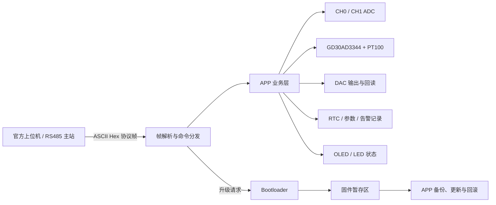

# GD32F4 CIMC GdLib 2026

> 基于 **GD32F470VE** 的 2026 年西门子杯中国智能制造挑战赛（CIMC）工业嵌入式系统开发方向完整参赛工程。

本项目获得 **2026 年西门子杯全国初赛特等奖**，软硬件部分的比赛成绩均接近满分。仓库公开了队伍 `2026837587` 的 APP、Bootloader、Keil 工程、参考固件、参赛文档及比赛相关资料。这不是只用于展示的代码片段，而是一套经过实际比赛和官方评测验证的软硬件实现。

| 项目 | 内容 |
| --- | --- |
| 主控 | GigaDevice GD32F470VE（Arm Cortex-M4） |
| 开发方式 | 裸机程序，Keil MDK + Arm Compiler 5 |
| 核心能力 | RS485 协议、数据采集、参数配置、阈值告警、低功耗和 Bootloader 升级 |
| 比赛成绩 | 2026 年全国初赛特等奖，软硬件成绩接近满分 |
| 参赛队伍 | `2026837587` |
| 开源许可 | 原创代码采用 MIT License；第三方代码和赛事资料适用各自条款 |

> [!IMPORTANT]
> 本仓库是参赛队伍的工程归档与交流版本，不代表赛事主办方或芯片厂商的官方实现。后续参赛者应以当届赛题和规则为准，在理解本项目的基础上独立完成自己的方案。

## 为什么开源

嵌入式项目很少只难在某一段代码。硬件接口、外设驱动、通信协议、数据处理、Flash 规划、Bootloader 和整机联调往往环环相扣，初学者很容易在资料查找和问题定位上花费大量时间。

我们希望把这套经过比赛验证的实现完整保留下来，为正在学习嵌入式开发、准备参加西门子杯，或想了解一个小型嵌入式系统如何从驱动走向完整业务的同学提供参考。你可以直接查看我们如何组织工程、拆分模块和处理实际问题，也可以在此基础上重新设计和改进。只要它能帮助后来者少走一些弯路，这次开源就有意义。

## 项目全貌

系统由主应用程序和独立 Bootloader 组成。上位机通过 RS485 与设备通信，APP 负责采集、控制和业务处理；进入升级流程后，Bootloader 接管 RS485，完成固件接收、备份、写入、校验和异常回滚。



程序上电后的主要路径如下：

1. Bootloader 初始化 RS485、OLED 和内部 Flash，读取设备 ID、波特率及升级启动标志。
2. 无升级请求时检查 APP 初始栈指针，设置向量表和主栈后跳转到 `0x08011000`。
3. APP 加载并校验持久化参数，随后初始化 RS485、ADC、DAC、GD30AD3344、RTC、OLED 和外部 SPI Flash。
4. APP 上电发送 `0x8888` 心跳帧，在主循环中处理命令、采样、告警检测、自动上报和状态显示。
5. 收到升级请求后，APP 使用 RTC 备份寄存器记录升级标志并复位，由 Bootloader 继续执行升级流程。

## 程序内容

### 主应用 APP

APP 是设备正常运行时的主体，入口为 [`APP/User/main.c`](APP/User/main.c)，系统初始化和主循环位于 [`APP/Function/sysFunction/Function.c`](APP/Function/sysFunction/Function.c)。

| 模块 | 实现内容 | 主要源码 |
| --- | --- | --- |
| 系统初始化 | SysTick、LED、参数、OLED、RS485、RTC、ADC、DAC、外部 ADC 与 SPI Flash 初始化 | `APP/Function/sysFunction/` |
| RS485 通信 | USART1 半双工收发、环形接收缓冲区和运行时波特率切换 | `APP/Driver/rs485/` |
| 帧协议 | ASCII Hex 流重组、设备地址过滤、帧校验、CRC-16/Modbus、命令分发与响应 | `APP/Protocol/` |
| 模拟量采集 | 读取 CH0 电位器和 CH1 DAC 回读，将 12 位 ADC 原始值换算为电压并应用通道变比 | `APP/Driver/adc/`、`APP/Function/adc_app.*` |
| PT100 测温 | 通过 SPI3 读取 GD30AD3344，计算电压、电阻及 PT100 温度 | `APP/Driver/gd32ad3344/`、`APP/Function/ad3344_app.*` |
| DAC 控制 | 设置 PA4 的 12 位 DAC 原始值或目标电压，输出范围自动限幅 | `APP/Driver/dac/`、`APP/Function/dac_app.*` |
| 参数持久化 | 保存设备 ID、波特率、通道变比、上报周期、阈值和告警记录，并使用 Magic、版本及 CRC 校验 | `APP/Function/param_app.*` |
| RTC 与时间戳 | UTC 秒级时间戳与 RTC 日期时间互转，支持上位机校时和时间查询 | `APP/Function/rtc_app.*` |
| 自动上报 | 按 1 s、3 s 或 5 s 周期发送时间戳及 CH0、CH1 数据 | `APP/Protocol/protocol.c` |
| 阈值告警 | 对 CH0、CH1 进行越限边沿检测，记录时间、通道、阈值和实测值，支持主动上报、查询和清除 | `APP/Protocol/protocol.c` |
| 低功耗 | 命令应答完成后进入深度睡眠，由 RTC 定时唤醒并返回唤醒信息 | `APP/Protocol/protocol.c` |
| 人机状态 | OLED 显示队伍编号及 `IDLE`、`AutoSample`、`Bootloader` 状态，LED 指示运行和采样 | `APP/Driver/OLED/`、`APP/Function/led_app.*` |

APP 采用清晰的分层结构：`Driver` 负责硬件，`Function` 封装业务能力，`Protocol` 负责通信和命令调度，`User` 保留程序入口与中断文件。对于正在学习裸机项目组织方式的读者，建议从 `main.c -> Function.c -> protocol.c -> 各 app/driver 模块` 依次阅读。

### RS485 协议

默认通信参数为 **19200 / 8N1**，接口使用 USART1：`PD5=TX`、`PD6=RX`、`PE8=DE`。APP 支持将波特率持久化为 4800、9600、19200 或 115200，Bootloader 会读取并沿用已保存的波特率。

协议在线路上传输 ASCII 十六进制字符。解码后的二进制帧结构如下：

| 字段 | 长度 | 说明 |
| --- | ---: | --- |
| 起始标志 | 2 B | 固定为 `A5 B6` |
| 设备 ID | 2 B | 支持单设备地址和 `0xFFFF` 广播地址 |
| 帧类型 | 1 B | 命令 `0x01`、应答 `0x02`、心跳 `0x05`、错误 `0xFF` |
| 命令字 | 2 B | 高字节表示功能类别，低字节表示具体指令 |
| 数据长度 | 1 B | 后续数据域长度 `N` |
| 协议版本 | 1 B | 当前固定为 `0x02` |
| 数据域 | N B | 参数或应答数据 |
| CRC | 2 B | CRC-16/Modbus |
| 结束标志 | 2 B | 固定为 `B6 A5` |

主要已实现命令：

| 类别 | 命令字 | 功能 |
| --- | --- | --- |
| 系统 | `0x0101`、`0x0104`-`0x0106` | 设备重启、固件版本、设置/查询 RTC 时间 |
| 设备参数 | `0x0111`、`0x0112`、`0x01A1`、`0x01A2` | 查询/设置设备 ID 与 RS485 波特率 |
| 数据采集 | `0x0201`、`0x0202`、`0x0221` | 查询 CH0、CH1 和 PT100 温度 |
| 采集配置 | `0x0241`、`0x0242`、`0x0261` | 设置通道变比和自动上报周期 |
| 控制 | `0x0301`-`0x0303`、`0x03AA` | DAC 输出、开始/停止自动上报、进入睡眠 |
| 阈值 | `0x0400`-`0x0402`、`0x0411`、`0x0412` | 查询或设置 CH0、CH1 阈值 |
| 固件升级 | `0x0501`-`0x0503` | 请求升级、准备接收固件、执行升级 |
| 告警 | `0x0601`-`0x0603` | 设置告警上报、查询和清除告警记录 |
| 特殊帧 | `0x8888`、`0xFFFF` | 上电心跳和广播设备发现 |

`0x0102`、`0x0103`、CH2 阈值及日志类命令目前只保留了协议定义，尚未实现业务处理。完整格式和测试示例可结合 [`docs/competition/`](docs/competition/README.md) 中的当届赛题阅读。

### Bootloader 与固件升级

Bootloader 位于 [`Bootloader/`](Bootloader/README.md)，通过与 APP 相同的 RS485 帧协议进入升级会话，固件数据本体按原始二进制流接收。

升级过程不是直接覆盖正在运行的 APP：

1. APP 收到 `0x0501`，应答后写入升级标志并软件复位。
2. Bootloader 检测升级标志，输出倒计时并在 10 秒窗口内等待 `0x0502`；普通上电也保留 5 秒静默窗口。
3. 擦除暂存区，接收带有 `5A A5 C3 3C` 头部的固件流，每 256 B 写入一次内部 Flash。
4. 固件接收结束且头部校验通过后，应答 `0x0502` 并等待 `0x0503`。
5. 执行升级前先将现有 APP 完整复制到备份区，再擦除并写入新 APP。
6. 写入后逐字节回读校验；写入或校验失败时，从备份区恢复原 APP。
7. 清理中断、SysTick 和向量表状态，设置 MSP 后跳转到 APP。

这部分代码集中在 [`Bootloader/Function/bootloader.c`](Bootloader/Function/bootloader.c)，适合用来学习 Cortex-M 应用跳转、内部 Flash 分区、升级状态机及失败回滚的基本实现。

## 快速开始

### 1. 获取仓库

```bash
git clone https://github.com/Qingqin26/gd32f4_CIMC_gdlib_2026.git
cd gd32f4_CIMC_gdlib_2026
```

### 2. 准备开发环境

- Keil MDK / uVision 5.41
- Arm Compiler 5（工程工具链标识为 `ARM-ADS`）
- GigaDevice GD32F4xx Device Family Pack
- GD32F470VE 目标板及对应下载器

工程文件当前引用 `GigaDevice.GD32F4xx_DFP 3.0.0`，原开发记录为 `3.0.3`。不同版本的 Keil 或 DFP 可能自动调整工程配置，首次打开后请检查目标器件、编译器、IROM 地址和下载算法。

### 3. 编译

1. 打开 `Bootloader/project/GD32_CIMC_GdLib_Bootloader.uvprojx` 并执行 Build。
2. 打开 `APP/Project/GD32_CIMC_GdLib_Code.uvprojx` 并执行 Build。
3. 确认 Bootloader IROM 起始地址为 `0x08000000`、大小为 `0x10000`。
4. 确认 APP IROM 起始地址为 `0x08011000`、大小为 `0x20000`。

构建产物默认生成到各工程的 `Objects/` 目录。仓库保留了比赛版本的 HEX 文件，便于核对和复现；`.uvoptx` 也随工程保留，用于参考原有调试和下载配置。

### 4. 烧录与运行

1. 先将 Bootloader 烧录到 `0x08000000`。
2. 再将 APP 烧录到 `0x08011000`。
3. 不要擦除或覆盖位于 `0x08010000` 的参数区。
4. 通过 RS485 连接上位机，首次通信使用 `19200 / 8N1`。
5. 设备启动后会显示队伍编号并发送 `0x8888` 心跳帧。

> [!WARNING]
> APP 不是从 GD32 Flash 默认基址启动。将 APP 烧录到 `0x08000000` 会覆盖 Bootloader；整片擦除还会清除设备参数、APP 备份和升级暂存内容。实际操作前请再次核对地址。

## Flash 布局

| 区域 | 起始地址 | 大小 | 用途 |
| --- | --- | ---: | --- |
| Bootloader | `0x08000000` | 64 KiB | 启动判断、升级接收、APP 校验与跳转 |
| 参数区 | `0x08010000` | 4 KiB | 设备 ID、波特率、变比、阈值和告警记录 |
| APP | `0x08011000` | 128 KiB | 主应用程序 |
| APP 备份区 | `0x08031000` | 128 KiB | 升级前备份，用于失败回滚 |
| 固件暂存区 | `0x08051000` | 128 KiB | 接收并暂存待升级固件 |

## 仓库结构

```text
.
|-- APP/
|   |-- Driver/          # ADC、DAC、RS485、OLED、Flash、GD30AD3344 等驱动
|   |-- Function/        # 采集、参数、RTC、LED 和系统主循环
|   |-- Protocol/        # 帧解析、CRC、命令处理和 HEX 转换
|   |-- Project/         # APP 的 Keil MDK 工程及参考 HEX
|   |-- User/            # main、SysTick 和中断入口
|   |-- Firmware/        # GigaDevice 标准外设库
|   |-- CMSIS/           # Arm CMSIS 与芯片支持文件
|   `-- Library/         # USB、FatFs 等第三方库
|-- Bootloader/
|   |-- Driver/          # Bootloader 使用的底层驱动
|   |-- Function/        # 升级、备份、写入、校验、回滚和 APP 跳转
|   |-- Protocol/        # Bootloader 命令帧处理
|   |-- project/         # Bootloader 的 Keil MDK 工程及参考 HEX
|   `-- User/            # Bootloader 入口与中断文件
|-- docs/
|   |-- competition/     # 赛题、官方工具、模板和本地评测环境
|   |-- submissions/     # 队伍工程设计文件与答辩材料
|   `-- hardware/        # GD30AD3344、GD30DC1354 等器件资料
|-- .github/             # Issue 与 Pull Request 模板
|-- CONTRIBUTING.md
|-- THIRD_PARTY_NOTICES.md
`-- LICENSE
```

## 预编译固件

| 固件 | 文件 | 烧录地址 | SHA-256 |
| --- | --- | --- | --- |
| Bootloader | [`Bootloader/project/Objects/CIMC_GD32_Template.hex`](Bootloader/project/Objects/CIMC_GD32_Template.hex) | `0x08000000` | `E28EBDB910C50697E6E44AE3DD4F43ED39EB30FA59ED1BDF401D7663B890A3C9` |
| APP | [`APP/Project/Objects/GD32_CIMC_GdLib_Code.hex`](APP/Project/Objects/GD32_CIMC_GdLib_Code.hex) | `0x08011000` | `DD53CAC305A5AAF9ADBEBDD38083363CDDC3212A9FDC49C5A0D9DAFC288990CA` |

这些校验值对应当前仓库中的参考文件。重新构建后，编译器版本、Pack 版本或优化选项的变化都可能使固件哈希不同。

## 文档与比赛资料

[`docs/README.md`](docs/README.md) 是全部资料的索引，其中包括：

- 2026 年工业嵌入式系统开发方向初赛赛题与硬件设计要求；
- 官方上位机、本地评测环境、测试固件和提交模板；
- 队伍 `2026837587` 的 42 页工程设计文件和答辩演示文稿；
- GD30AD3344 ADC、GD30DC1354 电源芯片等硬件参考资料。

赛事题面、官方工具、模板和厂商手册用于学习及环境复现，不属于本项目原创内容。运行仓库中的 EXE 文件前，请确认文件来源并在可信环境中使用。

## 阅读建议

如果你刚开始接触嵌入式，可以按以下顺序阅读：

1. 先看本 README 和 `docs/submissions/2026837587-dsn.pdf`，建立对系统需求和软硬件方案的整体认识。
2. 从 `APP/User/main.c` 和 `APP/Function/sysFunction/Function.c` 理解初始化及主循环。
3. 阅读 `APP/Protocol/protocol.c`，观察串口字节流如何变成命令，再如何调用业务模块。
4. 选择 ADC、DAC、RTC 或 GD30AD3344 中的一个模块，从应用层一路追踪到驱动层。
5. 最后阅读 `Bootloader/Function/bootloader.c`，结合 Flash 布局理解升级、备份和跳转流程。

建议先理解再移植。板级引脚、参考电压、Flash 页大小和启动地址都与当前硬件相关，直接复制到其他开发板不一定能够工作。

## 已知限制

- 本项目针对比赛指定硬件完成，未验证其他 GD32F4 型号或通用开发板。
- 当前没有自动化硬件在环测试；修改 Flash、时钟、RS485 或升级逻辑后需要在实物上回归。
- Bootloader 对 APP 的启动有效性检查以初始栈指针是否合法为主，不等同于完整镜像签名或安全启动。
- 升级固件使用固定 Magic 头和写后回读校验，不包含加密、数字签名或防回滚机制。
- PT100 换算、ADC 参考电压和通道变比基于比赛硬件，移植时需要重新标定。
- 源码中的部分中文注释采用本地编码，在 UTF-8 编辑器中可能显示乱码，建议使用 Keil 或按原编码打开。
- `Firmware`、`CMSIS`、USB 和 FatFs 等目录包含厂商或第三方代码，不应全部视为本项目原创实现。

## 贡献

欢迎通过 Issue 交流复现问题、硬件差异、协议理解和改进思路，也欢迎提交能帮助后来者学习的修复或文档补充。提交前请阅读 [CONTRIBUTING.md](CONTRIBUTING.md)。涉及固件升级等潜在安全问题时，请按照 [SECURITY.md](SECURITY.md) 私下报告，避免直接公开可利用细节。

## 许可证与致谢

除文件、目录或第三方声明另有规定外，本项目原创代码采用 [MIT License](LICENSE)。ARM CMSIS、GigaDevice 固件库、FatFs 及其他第三方组件继续适用各自的版权和许可条款，详见 [THIRD_PARTY_NOTICES.md](THIRD_PARTY_NOTICES.md)。

赛事题面、模板、工具和厂商手册不因存放在本仓库而自动采用 MIT License，其权利归原版权方所有。感谢赛事组织方、GigaDevice 以及相关开源组件的维护者。

如果这个项目为你的学习、调试或参赛准备提供了帮助，欢迎留下反馈，让后来的学习者也能看到更多真实的经验。
